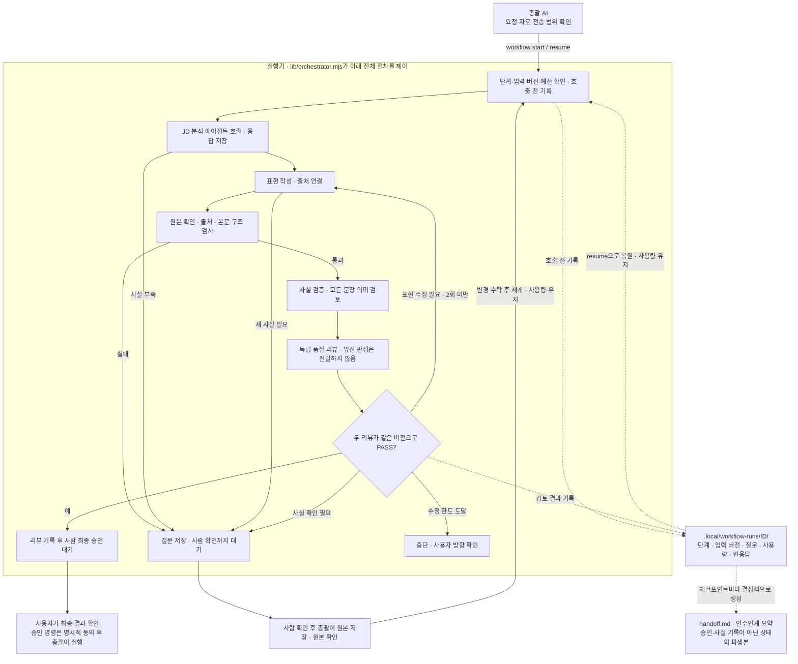

# 실행기: 단계 연결·표현 수정·중단과 재개

## 총괄 에이전트와 실행기의 책임

총괄은 사용자 요청을 해석하고 사람에게 확인할 사실·우선순위를 판단한다. 실행기(`lib/orchestrator.mjs`)는 정해진 순서대로 역할을 호출하고 저장·검증·재시도·예산을 관리하는 프로그램이다. 서브에이전트는 읽기 전용 입력으로 결과만 반환한다. 실행기가 총괄의 저장·호출 절차를 수행하지만 경력 사실을 대신 확인하거나 최종 승인하지 않는다.



위 자동 처리 영역의 사람 대기 노드는 실행기가 멈추는 지점이다. 사실 확인·원본 갱신은 사람이 확인한 범위에서 총괄이 수행한다. 모델은 결과만 반환하며 호출·저장·다음 단계 결정은 모두 실행기를 거친다. 역할별 호출·반환 관계는 [총괄·실행기·서브에이전트의 관계](WORKFLOW.md#2-총괄실행기서브에이전트의-관계)를 참고한다.

## 명령

프로젝트 루트에서 Node.js 22.12 이상으로 실행한다. Windows PowerShell 실행 정책 문제가 있으면 `npm.cmd`를 사용한다. 모델은 역할 TOML의 gpt-6.1-sol / medium을 사용하며 `--model`은 해당 실행에만 우선한다.

```sh
# README의 new 또는 new-representative로 대상 ID를 먼저 만든다.
npm run workflow -- start 지원ID --confirm-send

# 기존 초안에서 시작: 최초 분석·작성 생략, FAIL이면 표현 수정 가능
npm run workflow -- start 지원ID --review-only --confirm-send

# 상태와 사용량 확인, 예산 등으로 멈춘 단계부터 재개
npm run workflow -- status 지원ID
npm run workflow -- handoff 지원ID
npm run workflow -- resume 지원ID --confirm-send
```

`start`에서 `--confirm-send`를 생략하면 실행 상태만 만들고 모델을 호출하지 않는다. 한 지원 ID에는 하나의 실행 기록만 만들며 `start` 재호출로 수정·호출 한도를 초기화할 수 없다. 기존 초안을 전체 작성 흐름으로 다시 작성할 때도 자동 수정 회차를 사용한다. `--review-only`는 최초 분석·작성만 생략하며 리뷰 기록과 FAIL의 표현 수정은 수행한다. 파일을 바꾸지 않는 검토만 필요하면 단일 역할 runner로 두 리뷰 결과만 반환하고 실행기를 사용하지 않는다.

## 표현 수정과 사실 수정

- AI는 경력 원본을 읽고 출력 문장의 표현·배치·중복을 개선할 수 있다. 원본 `statements`와 출력 문장의 문자열이 같을 필요는 없다.
- 원본 확인의 유효성, 문장별 출처 ID, 본문과 provenance의 정합성, 버전 해시는 코드로 검사한다. 이 구조 검사 PASS를 사실 검증 PASS로 간주하지 않는다.
- verifier는 모든 claim에 대해 `claim_checks: [{claim_id, supported, reason}]`를 반환한다. 의미 검토 누락·중복 ID·supported=false이면 PASS를 인정하지 않는다.
- 품질 검토자는 같은 버전 자료를 받지만 작성 대화·수정 피드백·사실 검토자의 결론은 받지 않는다. 현재 구현은 두 검토자를 순서대로 호출하되 문맥은 각각 새로 만든다.
- 실행기는 같은 문서 해시·수정 회차의 두 독립 PASS를 확인한 후 PASS 리뷰를 기록한다. 두 리뷰 중 FAIL이 있고 질문이 없으면 FAIL 리뷰를 기록한 뒤 표현 수정 여부를 결정한다. NEEDS_INPUT이나 질문이 있으면 PASS/FAIL 리뷰 기록 대신 실행 상태와 질문을 저장하고 대기한다. 승인·다운로드 때도 저장된 두 결과와 문장별 검토를 다시 검사한다. 역할·실행 ID는 추적 정보이며 사람 인증이나 위조 불가능한 서명이 아니다.
- 기간·수치·기술·기여 등 새로운 사실이 필요하면 `NEEDS_INPUT`과 질문을 저장하고 대기한다. 실행기는 원본·원본 확인 기록·최종 승인 기록을 자동 생성하지 않는다.
- 사람이 새 사실을 확인하면 총괄이 경력 원본과 원본 확인 기록에 저장하고 해결된 질문을 정리한다. 표현 개선만으로 경력 원본을 바꾸지 않는다.

AI의 의미 검토는 오류 가능성이 있다. 출처를 붙였다는 사실이나 두 모델의 PASS만으로 현실의 경력이 증명되지 않는다. 최종 제출할 내용은 사람이 확인한다.

[검사별 책임과 예시](REVIEWS.md#검사별-책임과-보장하지-않는-것)를 참고한다. fact-review.json은 career verify가 저장하는 구조 검사 기록이다. 실제 AI 원응답은 로컬 실행 폴더에, 기록된 두 리뷰 증거는 quality-review.json의 agentReviews에 보관한다. 웹의 지원 상태(metadata.status)와 아래 실행 상태(state.status)는 별개다. 초안 생성 후 웹의 검토 대기는 AI 두 리뷰 완료를 뜻하지 않는다.

## 상태와 재개

진행 상태는 `.local/workflow-runs/지원ID/state.json`, 각 모델 결과는 같은 폴더의 호출 UUID `.json`에 저장한다. 모두 Git 제외 대상이다. 모델 호출 **전** 입력 버전·단계·시도 횟수를 저장하고, 결과가 오면 실제 사용량·검증·다음 단계를 저장한다. 임시 파일 후 rename으로 상태 파일을 교체한다. 에이전트가 종료 직전에 기록해 줄 것에 의존하지 않는다.

state.run_id는 전체 실행 식별자이고 각 모델 응답의 result.run_id는 호출별 UUID다. 실패 진단은 같은 폴더의 last-error.json, 실행 잠금은 owner.json에 저장한다. 모델 결과 파일은 정상 JSON으로 해석하고 현재 입력 일치를 확인한 응답에 대해 저장하므로, 프로세스·JSON 파싱·입력 변경 검사 단계에서 실패한 모든 호출의 원문이 반드시 남는 것은 아니다. 모델 이벤트의 stderr는 출력하지 않는다.

| 상태 | 의미와 다음 행동 |
| --- | --- |
| ready / running | 실행 준비 / 자동 단계 수행 |
| awaiting_human_input | 저장된 질문에 사람 확인 필요. 같은 입력으로 resume해도 모델을 다시 부르지 않음 |
| awaiting_human_approval | 두 독립 리뷰 통과. 기존 career approve 명령으로 사람이 최종 승인 |
| budget_exhausted | 다음 모델 호출 전에 예산 도달 감지. 사용량 유지 후 사용자 지시로 예산 변경 |
| repair_limit | 자동 수정 한도 도달. resume만으로 반복하지 않음 |
| stale | 입력 변경 감지. 이전 리뷰를 적용하지 않음 |
| version_mismatch | 코드·규칙·모델·프롬프트 변경 또는 실행 버전 미기록. 명시적 수락 전 재사용·모델 호출 차단 |
| interrupted / failed | 중단 또는 모델·결과·저장 오류. 호출 사용량과 실행 중 정보 유지 |
| completed | awaiting_human_approval에서 resume할 때 사람 승인 유효성을 확인하고 저장한 종료 상태 |

사용자가 원본이나 JD를 바꾼 경우:

```sh
# 경력 원본 변경이면 source-digest/source-approve를 사람 확인 후 먼저 실행한다.
npm run workflow -- resume 지원ID --accept-changes --confirm-send
```

입력이 바뀌면 이전 단계 결과는 재사용하지 않고 분석부터(검토 전용은 구조 검사부터) 다시 진행한다. 이미 쓴 호출·토큰·수정 횟수는 유지한다. 지원 ID도 그대로다. 승인·고정한 문서를 바꾸려면 기존 규칙대로 새 ID를 만든다.

`status`는 저장된 state 필드를 반환하고 health에 현재 입력/실행 버전 변경·프로세스 잠금·승인/고정 상태 진단을 덧붙인다. state.status를 자동 갱신하거나 모델 호출·승인을 수행하지 않는다. `completed` 실행은 resume해도 다시 검증·실행하지 않는다. 따라서 종료 후 직접 파일을 바꾼 경우에도 저장 상태는 completed일 수 있지만 health에 변경이 표시되고 웹·다운로드는 현재 자료로 다시 검사한다. completed를 현재 승인 보증으로 사용하지 않는다.

awaiting_human_input·awaiting_human_approval·repair_limit에서 입력과 실행 버전이 그대로면 resume은 호출 없이 대기를 유지한다. --accept-changes는 실제 입력 해시가 달라진 경우에만 재검토를 시작하며 단순 강제 재실행 옵션이 아니다. 버전/입력 불일치 후 원래 구성을 되돌려도 waitingStatus로 기존 사람 대기를 복원하여 우회하지 않는다. 분석·작성 역할은 FAIL과 NEEDS_INPUT 모두 사람 확인 대기로 처리한다. 두 리뷰 단계는 현재 모두 받은 뒤 취합하며, verifier가 NEEDS_INPUT이어도 형식이 유효하면 품질 역할까지 호출한 후 대기할 수 있다.

실행 입력 버전은 이력서 digest·수정 회차와 **verified에서 읽은 모든 경력**의 sourceDigest/usable을 포함한다. 사용하지 않은 경력이나 private·확인 만료 경력이 바뀌어도 실행 상태가 stale이 될 수 있다. 실제 runner에서 입력 변경이 먼저 감지되어 예외가 발생하면 failed로 기록될 수도 있으나 이전 응답을 현재 결과로 적용하지 않는 원칙은 같다. 완료본 승인 해시의 영향 범위는 실제 사용한 경력만 포함하므로 [해시별 범위](REVIEWS.md#해시별-범위와-변경-감지)를 구분한다.

Ctrl+C 또는 종료 신호를 받으면 실행 중 모델을 중단하고 가능한 상태를 저장한다. 호스트 강제 종료 후에는 실행 잠금이 남을 수 있다. 모든 프로세스가 종료됐는지 확인한 뒤 다음 명령을 사용한다.

```sh
npm run workflow -- recover 지원ID --confirm
npm run workflow -- handoff 지원ID
npm run workflow -- resume 지원ID --confirm-send
```

살아 있는 프로세스의 잠금은 제거하지 않는다. 이미 저장된 모델 결과가 있고 입력 버전이 같으면 재호출 없이 재사용할 수 있다. 결과를 받았는지 불확실한 호출은 자동 재시도하지 않으며 `--retry-interrupted`를 명시해야 한다. 실패한 호출도 호출 예산에서 차감한다. 콘텐츠 저장 트랜잭션의 잠금·복구는 별도로 기존 `career recover --confirm` 절차를 따른다.

복구 직후 무조건 --retry-interrupted를 붙이지 않는다. 현재 입력·실행 버전과 일치하는 캐시가 있으면 먼저 재사용하고, 결과가 없거나 명시적으로 버릴 때만 추가 비용 확인 후 재호출한다. inFlight.usageRecorded로 사용량 기록 여부를 추적하며 저장된 응답에서 복구한 usage를 중복 합산하지 않는다.

캐시 응답도 현재 계약 검사를 다시 거치므로 잘못된 JSON 결과가 저장되어 있으면 단순 resume으로 통과하지 않는다. --retry-interrupted는 저장된 결과의 재사용 대신 새 호출을 선택하며 이전 호출 비용은 유지한다. workflow recover는 owner.json의 PID가 죽었는지 확인하고 잠금만 제거한다. 내용 롤백·실행 초기화 명령이 아니며 잠금 파일이 없으면 복구할 파일이 없다는 오류가 날 수 있으므로 status와 파일 상태를 먼저 확인한다.

## 비용·시간 정책

`workflow-policy.json`이 새 실행의 기본 정책이다. 각 실행은 시작할 때 이 값을 저장하므로 파일을 나중에 바꿔 기존 실행의 한도를 몰래 초기화하지 않는다.

| 설정 | 기본값 | 강제 범위 |
| --- | --- | --- |
| maxRepairs | 2 | 실행기의 자동 수정 상한. CLI repair와 같은 metadata.retries 사용, 코드 상한 2 이하 |
| maxCalls | 12 | 모델 호출 전 예약·차감, 실패·불명확한 호출도 포함 |
| maxObservedTokens | 200000 | CLI가 반환한 input+output 사용량 누적 후 다음 호출 전 검사 |
| maxInputBytes | 1048576 | 패킷 크기 상한 |
| callTimeoutMs | 600000 | 모델 자식 프로세스의 제한 시간. 권한 probe 등 준비 작업 시간은 별도 |
| maxActiveMs | 1800000 | 체크포인트 사이 활성 시간 누적과 다음 호출 검사. resume 사이 대기는 제외 |

실제 토큰 사용량은 `codex exec --json`의 usage에서 읽는다. 캐시 토큰을 입력 토큰에 중복 가산하지 않는다. 사용량을 받지 못한 호출은 `unmeteredCalls`로 표시하고 호출 횟수로 제한한다. 토큰 한도는 다음 호출을 막는 기준이며 진행 중 호출의 토큰 수를 정확히 제한하거나 ChatGPT 계정 사용 한도·요금을 보장하지 않는다. 모델 서비스의 사용 제한으로 실패하면 기록을 보존하고 사람이 재개 시점을 정한다.

```sh
# 사용자가 추가 사용을 결정한 경우만 실행한다. 기존 사용량은 0으로 바뀌지 않는다.
npm run workflow -- budget 지원ID --max-calls 16 --max-tokens 300000 --confirm
npm run workflow -- resume 지원ID --confirm-send
```

사용자는 언제든 중단할 수 있다. 실행기는 스스로 예산을 늘리거나 기다렸다가 다시 호출하지 않는다. 금액 계산은 하지 않으며 실제 토큰·호출·활성 시간만 기록한다. 비용이 발생할 수 있는 재실행과 예산 확대는 총괄이 사용자 요청 범위에서 수행한다.

CLI는 start와 budget에서 --max-calls/--max-tokens/--max-active-ms를 적용한다. resume에 같은 플래그를 붙여 한도를 변경하지 말고 budget ID ... --confirm을 사용한다. maxRepairs/maxInputBytes/callTimeoutMs는 기본 정책 파일에서 설정하며 새 실행에 반영된다. 실행 중 owner.json 잠금이 있으면 budget 변경을 거부한다.

호출 횟수는 격리 probe·실제 모델 실행 전에 예약하므로 준비 단계 실패도 시도 횟수에 포함될 수 있다. 단일 agents run 호출은 실행기의 누적 예산에 포함되지 않는다. 역할 TOML의 모델·추론 강도는 호출 시 읽되 실행기에서는 저장한 executionVersion과 비교한다. start의 --model override는 실행 버전에 보존하여 resume에서 생략해도 유지한다. 다른 --model이나 역할/규칙 변경은 명시적 버전 수락 전 차단한다. 단일 agents run은 별도 실행이므로 이전 workflow의 override를 자동 상속하지 않는다.

활성 시간은 체크포인트 기준 누적이며 강제 종료 직전의 미기록 구간이나 동기식 준비 작업까지 정확하게 강제 종료하는 벽시계 상한은 아니다. 패킷은 먼저 공통 runner의 1MiB 하드 상한을 거친다. 이를 초과하면 입력 준비 실패로 awaiting_human_input, 더 낮게 설정한 실행기 입력 한도를 초과하면 budget_exhausted가 될 수 있다. 자료 분할·요약·선별을 자동 수행하지 않는다.

수정 회차는 호출 전에 예약한다. 수정 모델 실패·예산 중단이 있어도 이미 예약한 회차는 남으며 재개 때 중복 차감하지 않는다. 한도는 지원 ID의 metadata.retries와 실행 기록으로 강제한다. 새 ID 생성·직접 파일 편집·단일 runner 호출까지 합산하는 전역 비용/업무 식별 시스템은 아니므로, 같은 업무를 새 ID나 다른 경로로 반복해 한도를 우회하지 않는 규약을 함께 지킨다. career repair는 구조 검사가 실패했을 때만 원문 선택 재생성을 반복하며 AI 리뷰·의미 오류 수정 루프가 아니다.

## 자동 인수인계와 작업 일지

각 state.json 체크포인트 저장 후 같은 폴더의 handoff.md를 자동 생성한다. 모델 호출 없이 상태·대기 사유·누적 완료 역할 기록·사용량·버전·질문·다음 행동을 정해진 형식으로 요약한다. 완료 역할은 과거 이력도 포함하며 현재 자료의 검증 완료 증거가 아니다. 원본 state 저장이 기준이고 파생 요약 파일 저장에 실패해도 체크포인트를 취소하지 않는다.

`npm run workflow -- handoff 지원ID`는 상태와 현재 프로세스/입력/실행 버전을 읽어 최신 요약을 stdout으로 출력한다. state와 handoff.md를 수정하지 않고 모델도 부르지 않는다. 자동 파일이 없거나 오래돼도 이 명령으로 재구성할 수 있다. 실행 프로세스가 살아 있으면 중복 재개/복구를 제시하지 않고, 죽은 잠금이면 복구 후 다시 진단하도록 안내한다. 비용·전송·변경 수락·사실 확인·최종 승인 명령 안내는 실제 사용자 승인이 아니다.

WORK_LOG는 코드 개발 목적·사용자 결정·미완료 구현·다음 개발 작업을 기록한다. 실행기 단계·응답·사용량을 매번 복사할 필요가 없으며 대상 ID와 필요한 사용자 결정만 보충한다. 경력 사실은 content 원본, 자동 실행 상태는 state.json, 인수인계는 파생 handoff.md로 구분한다. 실행기는 개발 작업 전체나 대화의 정확한 토큰 위치를 복원하는 도구가 아니다. 사용 한도 회복 후 자동 재기동하지 않으며 .local을 잃으면 로컬 재개 기록도 잃으므로 다른 PC에는 필요한 기록을 안전한 비공개 방법으로 함께 전달한다.

## 실행 버전과 재검토

state.version=2에서 executionVersion과 versionHistory를 기록한다. executionVersion은 소스 커밋(없으면 null), 실제 실행 파일 codeDigest, rulesDigest, 결과 계약 버전, Node 버전, 역할별 실효 모델/추론 강도·전체 developer prompt/출력 스키마 해시, modelOverride, 종합 fingerprint를 포함한다. 원응답 execution.version에도 같은 버전 정보를 남긴다. 프롬프트 원문·사용자 홈·원격 URL·경력 내용은 이 메타데이터에 복제하지 않는다.

| 범위 | fingerprint에 사용하는 입력 |
| --- | --- |
| 실행 코드/의존성 선언 | lib의 모든 .mjs, scripts/workflow.mjs·agents.mjs·secrets.mjs, package.json·package-lock.json |
| 규칙 | AGENTS.md, docs/SUBAGENTS.md·REVIEWS.md·PERMISSIONS.md, 네 역할 TOML |
| 실제 역할 설정 | 모델 ID·추론 강도, roleInstructions가 만든 developer 지침 전체, resultSchema의 JSON Schema, RESULT_CONTRACT_VERSION |
| 런타임 | Node의 process.version |

Git 커밋 번호는 추적 정보이며 종합 fingerprint에는 넣지 않는다. 파일이 같고 안내 문서만 커밋했다면 커밋 번호가 달라도 재사용할 수 있다. 반대로 미커밋 코드·규칙 변경은 실제 파일 해시로 감지한다. content·.local·기본 workflow-policy.json·README/WORKFLOW/EXECUTOR 안내·웹 UI는 실행 fingerprint에서 제외한다. content는 기존 inputVersion, 예산은 시작 시 저장한 policy로 따로 관리한다. 모델 ID 기록은 제공자의 내부 가중치 고정이나 완전한 재현성·호스트 인증을 의미하지 않으며 설치된 node_modules/CLI 바이너리·OS·로그인 상태까지 해시하지 않는다.

```sh
# handoff/status의 차이와 비용 확인 후 실행 버전만 수락
npm run workflow -- resume 지원ID --accept-version-change --confirm-send

# 입력과 실행 버전이 모두 바뀌었다면 둘 다 명시적으로 수락
npm run workflow -- resume 지원ID --accept-version-change --accept-changes --confirm-send
```

새 버전 수락은 예전 응답을 그대로 인정하는 옵션이 아니다. 과거 모델 파일·버전 이력과 사용량은 보존하되 현재 단계 결과/캐시 연결을 지우고 분석부터(검토 전용은 구조 검사부터) 재검토한다. 기존 초안 재작성은 같은 수정 한도를 사용한다. 승인·고정한 문서는 새 지원 ID가 필요하다. 실행 버전이 없는 기록도 임의로 추측하지 않고 수락 전 모델 호출을 차단한다. 원본 확인·최종 승인·예산 확대를 대신 수락하지 않는다.

호출 전후 fingerprint와 반환 메타데이터의 버전·모델·추론 강도를 검사하며 실행 중 변경된 결과는 적용하지 않는다. 캐시도 같은 버전이어야 한다. 코드가 실행 중 교체되면 새 프로세스에서 원인을 확인하고 재개하는 것이 원칙이며, 버전 지문은 같은 OS 권한의 파일 조작을 막는 서명 체계가 아니다. 콘텐츠 리뷰/다운로드 게이트가 실행 fingerprint를 별도 승인 조건으로 사용하는 것은 아니므로, 종료된 실행 기록·현재 이력서 해시·실행 버전 검사를 혼동하지 않는다.

## 중요한 규칙의 관리 위치

| 위치 | 역할 |
| --- | --- |
| AGENTS.md | 사람·AI가 지킬 판단 원칙, 사실 확인과 저장 책임 |
| .codex/agents/*.toml | 역할별 모델·추론 강도·의미 검토 관점 |
| lib/agent-contract.mjs | 결과 스키마, 문장별 검토 누락·두 리뷰·해시 검사 |
| lib/workflow.mjs | 출처 구조·표현 저장·리뷰·승인·다운로드 검사 |
| lib/orchestrator.mjs | 단계 전환, 상태 저장, 수정 횟수, 사람 대기와 재개 |
| workflow-policy.json | 기본 호출·토큰·시간 한도 |
| lib/agent-runner.mjs | 읽기 전용 격리 실행 |
| lib/agent-definition.mjs | 역할 설정과 실제 developer 지침 구성 |
| lib/execution-version.mjs | 실행 코드·규칙·설정·프롬프트/스키마 버전 캡처 |
| lib/handoff.mjs | 상태 기반 인수인계·조건별 다음 행동 생성 |
| tests/orchestrator.test.mjs | 수정 루프·예산·중단·변경·사람 대기 회귀 검증 |

실행기는 사실 확인·최종 승인·Git·외부 지원을 대신하지 않는다. 사람이 확정한 사실은 공통 원본에 남기고, 표현 수정은 해당 이력서에만 저장한다.

CLI 이벤트 기준: [Codex 비대화형 실행 공식 문서](https://learn.chatgpt.com/docs/non-interactive-mode).
