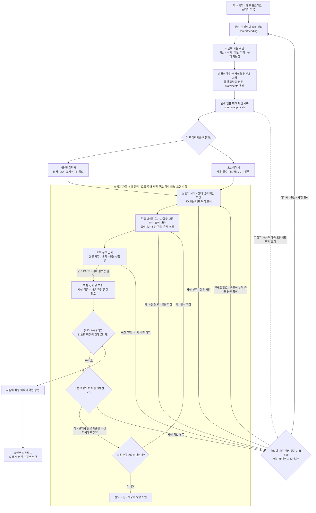
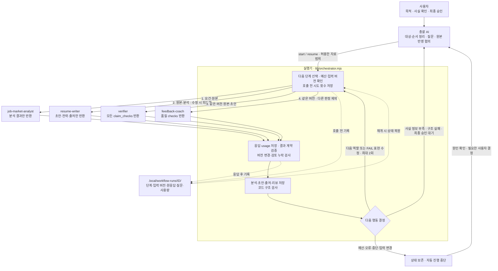
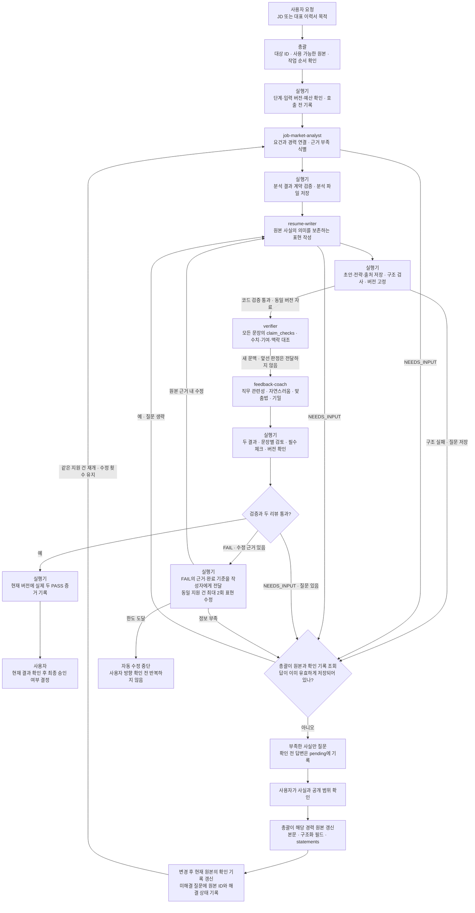
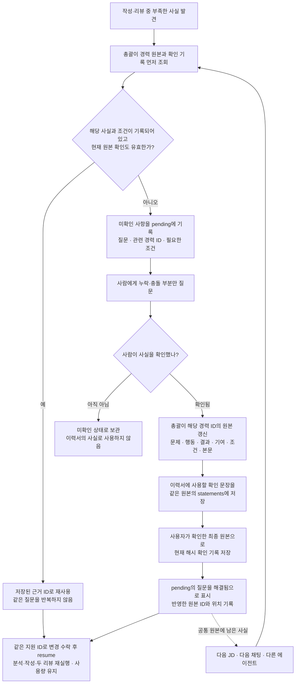
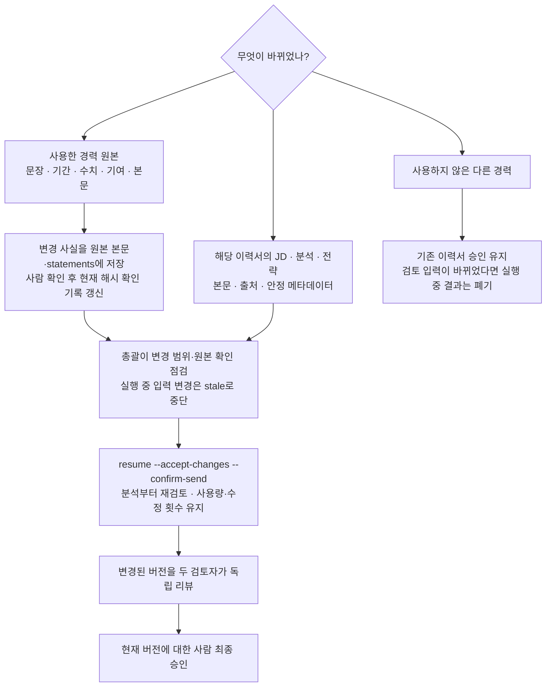
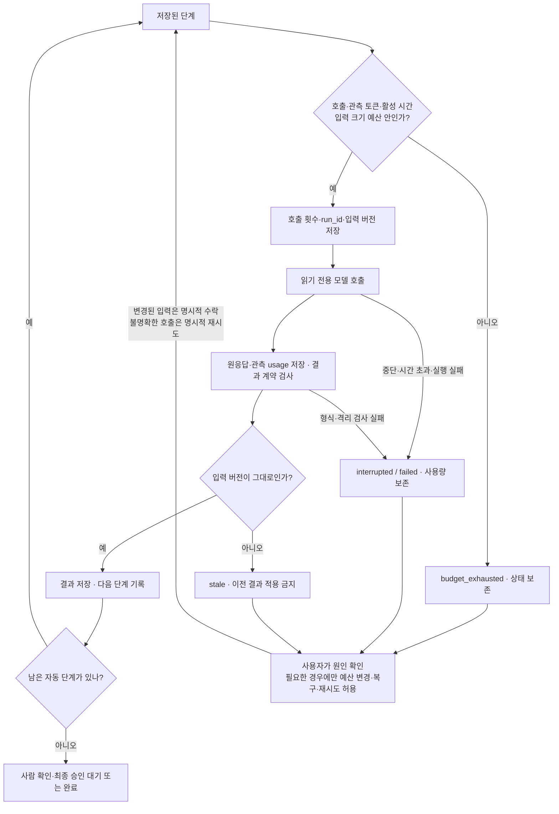

# 경력 관리와 이력서 작성 흐름

이 문서는 원본 경력이 어떻게 이력서와 연결되고, 누가 어느 단계에서 확인하는지 설명한다. 그림은 GitHub의 Markdown 미리보기에서 볼 수 있으며 Mermaid를 지원하는 편집기에서도 열 수 있다.

## 1. 전체 흐름

그림의 경력·원본 확인·이력서 데이터 경로는 `content/` 아래다. 경력 원본은 공통으로 관리하고 이력서는 `content/applications/ID/`에 지원 건·대표 버전별로 보관한다. 실행 상태·모델 응답은 별도 `.local/workflow-runs/ID/`에 남는다. 원본의 사실과 JD별 강조 전략을 섞지 않는다.

사용자가 새 사실을 확인해 주면 총괄이 해당 경력 ID의 원본에 실제로 저장하고 변경 후 원본의 확인 기록을 갱신한다. 이후 현재 지원 건을 재개하며 같은 회사·JD를 다시 요청하지 않는다. 다음 작업에서는 저장된 원본과 현재 확인 기록을 먼저 조회한다. 대화나 개인 작업 로그에만 답변을 남기고 작성으로 넘어가지 않는다.

기본 예시에는 원본 확인을 마쳤다고 가정한 확인 기록이 들어 있다. 사용자는 같은 형식의 콘텐츠를 본인 내용으로 교체한다. 원본이 바뀌면 기존 확인 기록이 만료되며, 본인 내용에 대한 사실 확인을 거쳐야 생성 근거로 사용할 수 있다. 원본 확인이 끝났다고 최종 이력서까지 승인되는 것은 아니다.

그림의 사람 최종 승인 단계에서는 사용자가 승인하지 않을 수 있다. 이 경우 총괄은 의견을 받아 요청 범위에서 초안·전략을 수정한 뒤 변경을 수락하여 재개하거나 작업을 멈춘다. 두 리뷰 PASS만으로 승인 명령을 실행하지 않는다. 구조 검사와 AI 리뷰의 책임은 다르며 두 PASS도 사실 오류 0%를 보장하지 않는다. 최종 확인자는 원본과 실제 경험을 대조한다.

## 2. 총괄·실행기·서브에이전트의 관계

실행기는 AI 역할이 아니라 `lib/orchestrator.mjs`로 구현된 제어 프로그램이다. 아래 화살표는 호출·결과 반환 관계이며 에이전트끼리 직접 통신하지 않는다. 호출 순서는 분석 → 작성 → 코드 구조 검사 → verifier → feedback-coach → 취합이다. 다음 절차를 결정하고 파일에 반영하는 주체는 매번 실행기다.

각 모델 호출 전후의 공통 절차를 그린 그림이다. 분석 결과만 받은 단계에서 이력서 리뷰를 저장하는 것은 아니다. 실행기는 현재 단계에 필요한 검증·저장만 수행하며, 두 리뷰가 모인 후에만 취합한다. 새 사실 저장·원본 확인·최종 승인은 자동 처리 영역 밖에 있다.

### 단계별 실행 흐름

- 총괄은 요청 해석·질문·원본 반영과 승인 협의를 담당한다. 실행기는 초안·전략·리뷰·실행 상태를 검증해 저장한다. 서브에이전트는 입력 자료를 읽고 결과만 반환한다.
- 각 역할은 새 Codex 프로세스에서 실행한다. 두 검토자는 같은 원본·JD·이력서·출처 버전을 받으며 작성 대화와 서로의 판정을 받지 않는다.
- 실행 전 권한 거부 검사가 실패하면 모델을 호출하지 않는다. 결과 형식·역할·실행 ID·문서 해시가 맞지 않아도 통과로 처리하지 않는다.
- 작성자는 원본 사실을 보존하는 다른 표현을 출력할 수 있다. 표현은 이력서에만 저장하고 코드 구조 검사 후 모든 문장의 의미 보존과 품질을 독립 검토한다. 새로운 사실이 필요한 경우만 사람에게 확인하여 공통 원본과 확인 기록을 갱신한다.
- 새로 확인된 사실은 총괄이 공통 경력 원본에 저장해 다음 분석·작성의 입력으로 전달한다. 사실 검증자와 품질 검토자는 갱신된 원본을 받으며 사용자 대화 전체를 전달받지 않는다. JD별 강조 순서나 표현 취향은 해당 지원 건의 전략에 기록하고 공통 경력 사실로 만들지 않는다.
- `NEEDS_INPUT`은 질문이 필요한 상태, `FAIL`은 수정이 필요한 상태다. 실행 오류나 검토 누락도 PASS가 아니다. 정보 부족이나 수정 한도 도달 시 반복을 계속하지 않는다.

그림은 역할과 업무 순서를 설명한다. 실제 실행기는 분석·작성의 FAIL도 사람 확인 대기로 처리하고, 두 리뷰는 모두 받은 후 NEEDS_INPUT/질문을 우선 확인한다. 질문 없는 리뷰 FAIL은 먼저 FAIL 기록을 저장한 뒤 근거와 한도를 검사해 수정한다. 원응답 형식 오류·실행 오류는 리뷰 FAIL로 대신 기록하지 않는다. 이미 확인된 사실을 찾아도 동일 입력의 사람 대기 상태가 자동으로 풀리지는 않으므로 총괄이 누락·충돌 원인을 해결하고 입력 변경이 필요하면 명시적으로 수락하여 재개한다.

총괄은 목적 해석·질문·사람 협의를 맡고 [실행기](EXECUTOR.md)는 `workflow start` 명령으로 분석·작성·구조 검사·두 리뷰·최대 2회 표현 수정과 저장을 이어 간다. 두 검토자는 현재 구현에서 순서대로 호출되지만 서로의 결론은 받지 않는다. 사람 사실 확인과 최종 승인 단계에서는 멈춘다. 웹은 읽기 전용이며 CLI `generate`는 모델 없는 문장 선택 보조 명령이다.

`--review-only`는 기존 초안의 **최초 분석·작성만 생략**한다. FAIL이면 실행기는 표현 수정과 리뷰 기록도 수행하므로 무변경 검토 옵션이 아니다. 파일을 변경하지 않는 검토만 요청받았다면 단일 역할 runner로 두 결과만 반환하고 실행기를 시작하지 않는다.

## 3. 새 사실을 한 번 확인한 뒤 계속 재사용하는 흐름

예를 들어 ‘팀이 개선했다’는 기록만 있고 본인의 기여가 불분명하면, 먼저 해당 경력 원본에서 기여 범위와 확인 여부를 찾는다. 기록이 없을 때만 질문한다. 사용자가 ‘쿼리 분석과 인덱스 변경을 직접 담당했다’고 확인하면 총괄이 `contribution`과 관련 본문을 보강하고, 사용할 문장을 `statements`에 저장한다. 원본에 명시되지 않은 성능 수치·측정 조건·주도 여부를 추가하지 않는다.

사용자가 확인한 문장과 저장할 내용이 같은 범위라면 같은 답변을 반복해서 물을 필요는 없다. 저장 과정에서 의미·수치·기간·기여 범위를 확장했거나 답변이 불명확하면 확인 기록을 만들기 전에 달라진 부분만 확인한다. 기록이 충돌하거나 원본 확인이 만료되면 필요한 부분을 재확인한다.

| 저장 대상 | 저장 위치 | 다음 작업의 사용 방식 |
| --- | --- | --- |
| 확인된 경력 사실과 맥락 | `content/career/verified/`의 해당 경력 ID 파일 | 분석·작성·검토의 공통 근거 |
| 경력 사실을 설명하는 확인 문장 | 같은 원본의 `statements` | 표현 작성의 근거로 사용하고 출력 문장의 의미 보존을 검토 |
| 변경한 원본의 확인자·시각·해시 | `content/source-approvals/경력ID.json` | 현재 원본 확인의 유효성 검사 |
| 질문의 해결 상태와 반영 위치 | `content/career/pending/`의 해당 질문 기록 | 미해결 질문을 다시 제시하지 않도록 조회 |
| JD별 강조·정렬 전략 | `content/applications/ID/tailoring-plan.md` | 해당 이력서의 작성 목적에만 적용 |

이 절차는 총괄이 수행하는 파일 기반 기록 규약이다. 현재 CLI가 대화 답변을 자동 수집·추출하는 것은 아니다. 다른 채팅·에이전트가 같은 사실을 재사용하려면 해당 저장소의 원본과 작업 지침을 읽어야 한다.

## 4. 변경이 생기면 어디부터 다시 진행할까?

승인·고정한 이력서를 수정하려면 새 지원 ID로 새 버전을 만든다. 관련 없는 경력이 바뀌어도 기존 이력서 승인은 만료되지 않지만, 진행 중인 에이전트가 받은 입력이 바뀌면 그 실행 결과는 적용하지 않는다.

`--review-only` 실행은 변경 수락 후 구조 검사부터 다시 진행한다. 실행기는 verified 전체 경력(사용하지 않은 경력·private·확인 만료 기록 포함)의 입력 버전을 보수적으로 추적하므로, 현재 이력서에 쓰지 않은 원본 변경도 실행 상태를 stale로 만들 수 있다. runner가 먼저 변경을 감지해 예외를 반환한 경우에는 failed로 기록될 수 있다. 둘 다 이전 결과를 현재 자료에 적용하지 않으며 기존 이력서 승인 해시의 영향 범위와 구분한다. 해시별 정확한 입력 범위는 [리뷰 지침](REVIEWS.md#해시별-범위와-변경-감지)을 따른다.

## 5. 화면과 파일에서 확인하는 위치

| 확인하려는 내용 | 웹 화면 | 저장 위치 |
| --- | --- | --- |
| 회사·프로젝트·스터디 업무와 원본 확인 상태 | 경력 라이브러리 | `content/career/verified/`, `content/source-approvals/` |
| 확인 전 질문과 기록 | 별도 웹 편집 기능 없음 | `content/career/pending/` |
| 회사·JD별 이력서 | 지원별 이력서 | `content/applications/ID/` |
| 회사·JD가 선택적인 기본 이력서 | 대표 이력서 | 같은 폴더, `kind: representative` |
| 문장과 근거 경력 연결 | 출처 비교·이력서 상세 | `provenance.json`, `resume.md` |
| 현재 검증·리뷰·최종 승인 | 이력서 상세의 검토 체크포인트 | 현재 데이터 재검사, `quality-review.json`, `metadata.json` |
| 작업 순서·검증·다음 작업 | 개인 작업 기록 | `.local/WORK_LOG.md` — Git 제외 |
| 실행 단계·모델 원응답·질문·사용량·재개 지점 | 웹 전용 화면 없음, workflow status | `.local/workflow-runs/ID/` — Git 제외 |

웹은 조회용이다. 콘텐츠 저장 후 새로고침하면 반영된다. 실행기는 분석·작성·검사·리뷰 기록을 자동 연결하고, 원본 확인·최종 승인은 사람 지시 후 총괄이 CLI로 처리한다. 초안 조회와 웹 빌드가 가능하더라도 제출 가능한 상태인지는 별도 검증한다. 웹의 지원 metadata 상태와 실행기 state.status는 별개이며, 웹의 검토 대기만으로 두 리뷰 완료를 판단하지 않는다. 외부 채용 사이트 지원, Git 푸시, 알림 전송은 각각 별도 요청에 따른다.

## 6. 중단·예산·입력 변경과 재개

실행기는 스스로 예산을 확대하거나 계정 한도 초기화를 기다렸다가 다시 호출하지 않는다. 결과가 저장되어 있고 입력이 같으면 재호출 없이 복구할 수 있다. 토큰은 관측한 실제 사용량을 다음 호출 전에 검사하는 기준이며 진행 중 호출의 초과를 완전히 막는 상한은 아니다. 잠금 복구·재시도·예산 명령은 [실행기 문서](EXECUTOR.md#상태와-재개)를 따른다.

status는 마지막 저장 체크포인트이며 현재 콘텐츠의 재검증이 아니다. completed 실행은 재개해도 종료 상태를 그대로 반환하므로, 현재 승인·다운로드 가능 여부는 공통 submissionState와 웹 다운로드 게이트로 확인한다. 수정 한도는 같은 지원 ID에 적용하며 새 ID·단일 runner까지 합산하는 전역 비용 시스템은 아니다.

명령 예제는 [README](../README.md), 역할별 모델·입출력·수정 한도는 [서브에이전트 실행 규약](SUBAGENTS.md), 권한 제한은 [권한 규약](PERMISSIONS.md)을 참고한다.
